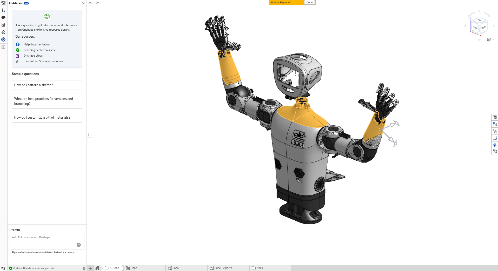

# pib: Referenzreise von der Bauteilauswahl zum Druck

Stand: 2026-10-16. Fachliches Zielbild und Grundlage für zukünftige Abnahmen.
Anforderungen und Freigaben: [Produktvision](vision-and-features.md).

## Visueller Ausgangspunkt

Vom Menschen bereitgestellter Screenshot, betrachtet am 2026-10-16. Er zeigt pib
in Onshape mit Kopf, Rumpf, Armen und Händen. Aufnahmezeitpunkt und CAD-Revision
sind hier nicht belegt. Die hervorgehobenen Bereiche legen weder ein zu änderndes
Bauteil noch eine freigegebene Änderung fest.

Das Bild verankert die Produktvision in einem konkreten Entwicklungsprojekt.
Die links sichtbare Onshape-Oberfläche gehört zum Screenshot. Der Nutzerkontakt
für ClawOnshape bleibt der Robotics Lead im jeweiligen Channel, beispielsweise
Discord #clawcad. Werkzeuge und deren Status erscheinen im Engineer-Dashboard.

## Ausgangssituation und gewünschter Nutzen

Ein kleines Team baut pib auf oder entwickelt ihn weiter. Es möchte ein
vorhandenes Bauteil aus der Baugruppe auswählen und fertigen. ClawOnshape soll
den Zusammenhang zwischen Auswahl, CAD-Stand, Freigaben, Druckdatei und
Druckauftrag nachvollziehbar halten. Eine Änderung des Modells ist für diese
Reise keine Voraussetzung. Der Mutation-Use-Case wird am Plattenbeispiel in der
[Produktvision](vision-and-features.md#nutzerreise-1-eine-platte-gezielt-verändern)
veranschaulicht.

Illustratives Szenario, noch kein beschlossener Entwicklungsauftrag:

> „Wir brauchen ein Verkleidungsteil des pib-Unterarms. Zeige mir das passende
> Teil und bereite nach meiner Produktionsfreigabe ein Exemplar für den Druck vor.“

Welches Teil, welche Seite, welcher Stand und welche Fertigungsanforderungen
gemeint sind, wird anhand einer echten Teamaufgabe festgelegt. Das Bild allein
liefert dafür keine ausreichenden technischen Angaben.

## Durchgängige Nutzerreise

Die Schritte sind erwartetes Produktverhalten, keine Behauptung bereits
ausgeführter pib-Aufträge. Die IDs verweisen auf die Produktanforderungen.

| Schritt | Situation und Nutzerhandlung | Erwartetes Ergebnis | Nachweis bei einer echten pib-Aufgabe | Anforderungen |
| --- | --- | --- | --- | --- |
| 1. Bedarf klären | Team beschreibt dem Robotics Lead im Channel, welches Teil für pib gebraucht wird. | Verwendungszweck, Menge und Anforderungen sind verständlich geklärt. | Ursprünglicher Auftrag und bestätigte Aufgabenbeschreibung. | K1, F1 |
| 2. Teil finden | Team lässt sich das passende Bauteil in der Baugruppe zeigen. | Lead liefert eine belegte Erklärung mit passender CAD-Ansicht. | Benannter CAD-Stand, Ansicht und geprüfte Beobachtungen; Annahmen sind gekennzeichnet. | K2, F2 |
| 3. Auswahl bestätigen | Team bestätigt das genaue Teil und gegebenenfalls die Seite. | Die Auswahl für die Fertigung ist eindeutig. | Bestätigtes Bauteil, CAD-Stand und Menge. | F2 |
| 4. Produktion freigeben | Berechtigter Mensch entscheidet, welches Teil in welchem Stand gefertigt werden darf. | Eindeutiger Produktionsauftrag für den ausgewählten CAD-Stand. | Produktionsfreigabe mit CAD-Stand und Teileauswahl. | F4 |
| 5. STL bereitstellen | Team erwartet eine passende Fertigungsdatei. | Engineer erzeugt das STL und übergibt es mit dem Auftragskontext an seinen Druck-Subagenten. | Zugängliches STL mit Herkunft und geprüften Abmessungen; Übergabe bestätigt oder begründet blockiert. | F5, F6 |
| 6. Druck vorbereiten | Team beurteilt den vorgeschlagenen Druck. | Vorbereitung in Bambu Studio mit ausgewähltem Drucker/Profil, Vorschau, Schätzungen und relevanten Hinweisen. | Prüfbares Vorbereitungsergebnis, verwendete Einstellungen, zugehöriges STL und konkreter Zieldrucker. | F7 |
| 7. Druck starten | Berechtigter Mensch gibt den konkreten Druckauftrag separat frei. | Druck-Subagent startet den freigegebenen Auftrag; Lead meldet den bestätigten Status im Channel. | Druckstartfreigabe, bestätigter Auftrag und bekannter Abschluss- oder Fehlerzustand. | F8, F9, K1 |
| 8. Am pib verwenden | Mensch prüft das gefertigte Teil und verwendet es beim Aufbau des Roboters. | Team kann beurteilen, ob das richtige Teil in der benötigten Qualität vorliegt. | Menschlicher Befund zu den vereinbarten Erfolgskriterien und gegebenenfalls eine neue Aufgabe. | Produktabnahme und Lernen aus Nutzung |

Die menschliche Montage und Erprobung im letzten Schritt schließen die
Nutzenbewertung ab. Daraus folgt keine Anforderung an automatisierte Montage,
Robotersteuerung oder autonome physische Prüfung.

## Das Dashboard begleitet die Reise

Das Mechanical-Engineer-Dashboard zeigt Onshape und die lokale Bambu-Studio-
Instanz mit Status und verfügbaren Fähigkeiten. Der Betrachter erkennt den
relevanten Team-/Projektkontext sowie den Auftragsstand und offene Blockaden.
Der Robotics Lead vermittelt die dazu passende Rückmeldung im Channel.
Die konkreten Anforderungen stehen unter D1–D5 in der Produktvision.

Beispiel eines notwendigen Fehlerfalls: Ist Bambu Studio nicht nutzbar, bleibt
erkennbar, welches freigegebene STL bereits vorliegt und warum die Vorbereitung
blockiert ist. Das Team erhält einen verständlichen nächsten Schritt. Ein
unbekannter Druckstart wird zuerst geklärt, bevor ein weiterer Start erwogen wird.

## So wird künftiger Produktfortschritt nachvollzogen

Für jede ausgewählte pib-Aufgabe werden die Belege entlang derselben Reise
geführt. Vorhandene Nachweise werden verlinkt; ein erfolgreicher Einzelschritt
gilt nicht als Erfolg der gesamten Reise.

Pro Aufgabe werden fachlich festgehalten:

- Team, Channel, betroffene pib-Baugruppe beziehungsweise Bauteil und Anliegen.
- Gewünschtes Ergebnis und prüfbare Erfolgskriterien.
- Zugehörige CAD-Stände, Freigaben, STL, Druckvorbereitung und Druckauftrag.
- Je Schritt: offen, in Bearbeitung, blockiert oder mit Nachweis abgenommen;
  Datum, Beleg und nächster erforderlicher Schritt.
- Ergebnis der menschlichen Erprobung und Entscheidung über eine weitere Iteration.

Diese Angaben definieren die Nachvollziehbarkeit. Sie schreiben kein technisches
Speicherformat oder zusätzliches System vor.

## Heutiger Nachweisstand

- Die Verwendung von pib als Referenzprojekt und des Bilds als visueller Anker
  ist vom Menschen vorgegeben.
- Für diese pib-Reise wurde hier noch kein konkreter Fertigungsauftrag ausgewählt
  oder abgenommen. Alle Schritte der obigen Tabelle sind Zielverhalten.
- Allgemeine bisherige Produktbelege sind in der
  [Produktvision](vision-and-features.md#belegstand-und-bestehende-grenzen)
  verlinkt. Sie ersetzen keine durchgängige Abnahme an einer pib-Aufgabe.

Als nächster fachlicher Schritt wird ein konkretes vorhandenes pib-Bauteil mit
Fertigungsanforderungen und Erfolgskriterien ausgewählt. Es dient durchgehend
als Beispiel und Abnahmefall von der Auswahl über STL bis zum Druck. Ergibt sich
Änderungsbedarf, kann die separat beschriebene Mutationsreise vorgeschaltet werden.
