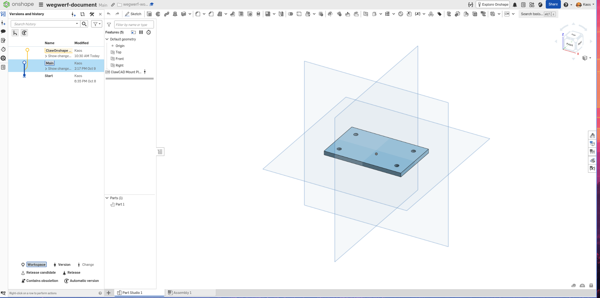
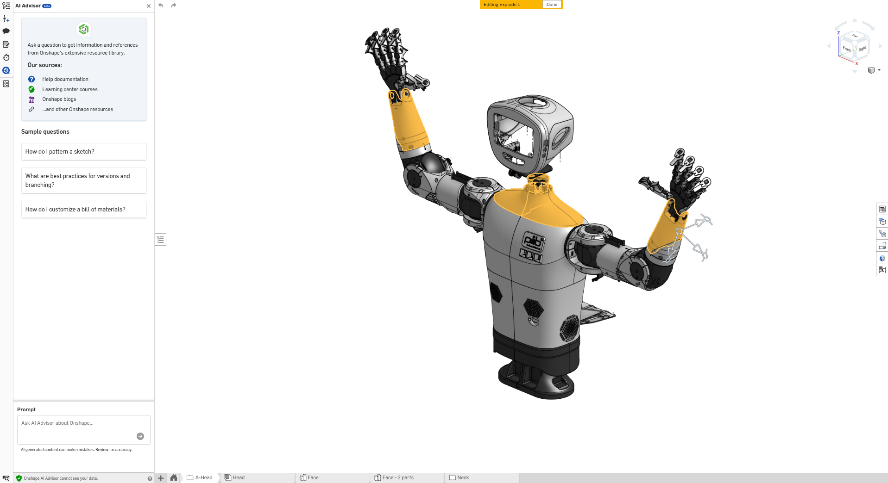

# Produktvision und notwendige Features

Stand: 2026-10-16. Fachliche Anforderungen für die Architektur auf Basis der
Produktentscheidungen im Gespräch mit dem Menschen.
Keine Implementierungs-, Aktivierungs- oder Deployment-Freigabe.

Dieses Dokument beschreibt benötigte Fähigkeiten, Nutzerergebnisse und
Abnahmekriterien. Integrationswege, Schnittstellenentwurf, Verteilung auf Services
und Harness sowie technische Umsetzung verantwortet der Architekt. Es gibt keine
Vorgabe für CLI, Bedienautomation, Transport oder zusätzliche Infrastruktur.

## Vereinbarte Richtung

ClawOnshape hilft kleinen Teams, ihre Konstruktionen gemeinsam weiterzuentwickeln
und ausgewählte Bauteile zu fertigen. Ein Teammitglied beschreibt sein Anliegen
im gewohnten Channel. Der Robotics Lead führt durch die Aufgabe und liefert ein
Ergebnis, das sich ansehen, beurteilen und weiterverwenden lässt.

Zwei Nutzerreisen machen dieses Versprechen greifbar: Eine einfache Platte zeigt,
wie aus einem Änderungswunsch eine geprüfte CAD-Variante wird. Die pib-Baugruppe
zeigt, wie ein Team ein vorhandenes Bauteil auswählt und über STL und Bambu Studio
bis zum freigegebenen Druck gelangt. Beide Reisen können zusammenhängen:
Eine geprüfte Änderung kann anschließend zur Produktion freigegeben werden.
Ein bereits passendes Bauteil kann direkt in die Fertigungsreise einsteigen.

Der Nutzen ist eine zusammenhängende, prüfbare Übergabe zwischen Konstruktion und
Fertigung. Dass Teams dadurch Zeit sparen und weniger Übergabefehler machen,
ist eine zu prüfende Nutzenhypothese.

## Nutzerreise 1: Eine Platte gezielt verändern

*Referenz für den Mutation-Use-Case: ein überschaubares Bauteil, an dem sich
Ausgangszustand, gewünschte Änderung und Ergebnis gut vergleichen lassen.*

Ein Team möchte die Befestigung dieser Platte anpassen. Statt selbst nach dem
passenden CAD-Parameter zu suchen, formuliert es den gewünschten Zustand beim
Robotics Lead. Ein beispielhafter Auftrag lautet:

> „Prüfe die vier Befestigungsbohrungen dieser Platte. Bereite eine Variante mit
> 5 mm Bohrungsdurchmesser vor. Positionen und Außenmaße sollen erhalten bleiben.“

Die 5 mm sind ein illustrativer Zielwert. Tatsächliche Maße, Bauteilzuordnung und
Änderbarkeit müssen am Modell festgestellt werden; sie werden nicht aus dem
Screenshot abgeleitet.

| Moment der Reise | Was das Team erlebt | Was das Produkt leisten muss |
| --- | --- | --- |
| Verstehen | Der Lead zeigt die Platte und erklärt die aktuellen Bohrungen. Unklarheiten werden gezielt geklärt. | Das richtige Bauteil und den CAD-Stand bestimmen; relevante Eigenschaften belegt lesen. |
| Änderung beurteilen | Das Team sieht, was geändert werden soll und welche Eigenschaften erhalten bleiben sollen. | Einen konkreten Vorschlag mit Zielwerten und prüfbaren Bedingungen vorlegen. |
| Änderung freigeben | Ein berechtigter Mensch gibt den vorgeschlagenen Eingriff frei. | Die bestehende Änderungsfreigabe auf genau diesen Vorschlag beziehen. |
| Variante erhalten | Der Lead liefert die geänderte Variante mit Vorher-/Nachher-Ansicht und Prüfergebnis. | Die Mutation in einem Candidate, also einer getrennten Arbeitsvariante, ausführen und die vereinbarten Eigenschaften prüfen. |
| Entscheiden | Das Team kann die Variante annehmen, überarbeiten lassen oder anschließend zur Produktion freigeben. | Belegte Ergebnisse und noch offene fachliche Fragen verständlich darstellen. |

Der entscheidende Nutzen: Das Team kann nachvollziehen, ob sein Änderungswunsch
erfüllt wurde. Eine Aussage wie „Änderung erfolgreich“ genügt nicht. Im Beispiel
müssen der neue Durchmesser sowie die vereinbarte Erhaltung von Positionen und
Außenmaßen geprüft oder verbleibende Prüfgrenzen ausdrücklich benannt werden.
Die sichtbare Onshape-Historie veranschaulicht den Bezug zu unterschiedlichen
Ständen; sie belegt für sich keine erfolgreich ausgeführte Mutation.

## Nutzerreise 2: Ein pib-Bauteil auswählen und drucken

*Referenz für die Fertigungsreise: vom gewünschten Teil innerhalb einer
Robotikbaugruppe zu einer eindeutig zugeordneten Druckdatei und einem Druckauftrag.*

Beim Aufbau oder bei der Weiterentwicklung von pib benötigt das Team ein
vorhandenes Bauteil. Die Aufgabe beginnt mit der Auswahl: Welches Teil aus der
Baugruppe wird gebraucht, in welchem Stand und in welcher Stückzahl?

> „Wir brauchen ein Verkleidungsteil des pib-Unterarms. Zeige mir das passende
> Teil und bereite nach meiner Produktionsfreigabe ein Exemplar für den Druck vor.“

Auch dies ist ein Beispielauftrag. Der Lead klärt anhand einer Ansicht das genaue
Teil und gegebenenfalls die Seite. Die gelben Hervorhebungen im Bild dienen der
Orientierung; sie sind keine verbindliche Teileauswahl oder Produktionsfreigabe.

| Moment der Reise | Was das Team erlebt | Was das Produkt leisten muss |
| --- | --- | --- |
| Teil auswählen | Der Lead zeigt das gemeinte Bauteil im Zusammenhang mit pib; das Team bestätigt die Auswahl. | Baugruppe, konkretes Teil, CAD-Stand und gewünschte Menge eindeutig zuordnen. |
| Produktion freigeben | Das Team entscheidet, dass genau dieses Teil gefertigt werden soll. | Die Produktionsfreigabe für den ausgewählten Stand festhalten. |
| STL erhalten | Eine dem ausgewählten Teil zugeordnete Datei steht bereit. | Das STL aus dem freigegebenen Stand erzeugen und an den Druck-Subagenten des Mechanical Engineer übergeben. |
| Druck beurteilen | Der Lead liefert das in Bambu Studio vorbereitete Ergebnis mit Vorschau, Drucker, Material und Schätzungen. | STL prüfen, passende Profile verwenden, slicen und das Ergebnis verständlich zur Prüfung vorlegen. |
| Druck starten | Ein berechtigter Mensch gibt den konkreten Druckauftrag separat frei. | Den passenden Auftrag starten und bestätigten Fortschritt beziehungsweise Fehler im ursprünglichen Channel melden. |
| Ergebnis verwenden | Das Team prüft das gefertigte Teil und verwendet es beim Aufbau von pib. | Die Zuordnung zum Auftrag erhalten; die menschliche Rückmeldung dient der Nutzenbewertung. |

Diese Reise ist auch ohne CAD-Änderung vollständig. Ihr Nutzen liegt darin,
dass vom ausgewählten Teil bis zum Druckauftrag erkennbar bleibt, was gefertigt
wird. Wird vorher eine Mutation benötigt, liefert Reise 1 die geprüfte Variante
als Ausgangspunkt. Die [pib-Referenzreise](pib-user-journey.md) beschreibt die
Fertigungsreise und ihre künftigen Abnahmebelege ausführlicher.

Beide Bilder sind vom Menschen bereitgestellte Referenzen, keine Nachweise einer
bereits abgenommenen ClawOnshape-Nutzerreise. Die Kommunikation mit dem Team läuft
über den Robotics Lead im jeweiligen Channel. Der im pib-Screenshot sichtbare
Onshape AI Advisor ist keine vereinbarte ClawOnshape-Nutzeroberfläche.

## Vereinbarter Produktumfang

Explizite Nutzerentscheidungen:

- Zielgruppe: mehrere kleine Teams mit eigenen Projekten und Druckern.
- Die Platte ist das Referenzbeispiel für Mutation. pib dient als Referenzprojekt
  für Bauteilauswahl, STL-Erzeugung und Druck. Die Mehrteam-Zielgruppe bleibt bestehen.
- Der Robotics Lead ist die Schnittstelle zum Team/User. Er antwortet im
  jeweiligen zugeordneten Channel, beispielsweise Discord → #clawcad.
- Der Mechanical Engineer besitzt ein eigenes Dashboard. Dort sind seine
  verfügbaren Werkzeuge, deren Status und nutzbare Fähigkeiten sichtbar.
- Erste Anwendung für Druckvorbereitung: Bambu Studio von Bambu Lab, mit
  Druckerauswahl, STL-Import und Slicing. Konkrete Druckermodelle sind noch offen.
- Nach Produktionsfreigabe soll ein STL aus dem ausgewählten CAD-Stand erzeugt
  werden. Eine vorgelagerte Mutation ist bei Änderungsbedarf möglich.
- Das STL geht an einen Subagenten des Mechanical Engineer für den 3D-Druck.
- Dieser prüft das STL, bereitet den Druck vor und darf nach einer separaten
  menschlichen Freigabe den physischen Druck starten.

## Rollen im Zielprodukt

| Rolle | Verantwortung |
| --- | --- |
| Mensch im Team | Anforderungen und fachliche Entscheidungen; Produktionsfreigabe; separate Druckstartfreigabe innerhalb seiner Berechtigungen |
| Robotics Lead | Zentraler Nutzerkontakt: Anliegen verstehen, offene Anforderungen klären, Engineer beauftragen sowie Fortschritt, Freigabebedarf und Ergebnisse im jeweiligen Channel kommunizieren |
| Mechanical Engineer | CAD untersuchen, Änderungen vorschlagen, freigegebene Candidate-Mutation ausführen, Ergebnis prüfen und freigegebenen Stand mit STL an den Druck-Agenten übergeben |
| 3D-Druck-Subagent | STL prüfen, Druckprofil und Druckauftrag vorbereiten, Risiken und offene Punkte melden; nach gesonderter Freigabe am zugeordneten Drucker starten und Ergebnisstatus zurückgeben |
| Operator | Integrationen, Berechtigungen, Inbetriebnahme und Deployment; Clawake behält den Container-Lifecycle |

Die Unterordnung des Druck-Agenten ist eine fachliche Produktanforderung.
Der Mechanical Engineer verantwortet das zusammenhängende technische Ergebnis
einschließlich der Druckvorbereitung seines Subagenten. Das Team muss interne
Delegationen nicht selbst organisieren. Die technische Realisierung dieser
Zusammenarbeit verantwortet der Architekt.

## Vorgegebener Werkzeugkontext

Vom Menschen vorgegebene Rahmenbedingungen, keine hier durchgeführten Runtime-Prüfungen:

- Onshape ist ein online verfügbares CAD-Werkzeug und über REST erreichbar.
- Bambu Studio ist eine lokale Instanz, die vom Mechanical Engineer erreichbar ist.
- Beide Werkzeuge gehören in die Übersicht des Mechanical-Engineer-Dashboards.

Die Anforderungen behandeln diese Werkzeuge als Fähigkeiten der Produktreise.
Wie Services, Agenten und Harness zusammenwirken, entscheidet die Architektur.

## Kommunikation und Mechanical-Engineer-Dashboard

| ID | Notwendige Anforderung | Abnahmekriterium |
| --- | --- | --- |
| K1 | Der Robotics Lead übernimmt die Kommunikation mit Team/User im jeweiligen Channel. | Auftrag, Rückfrage, Fortschritt, Freigabebedarf, Ergebnis und Fehler bleiben dem richtigen Team und Channel zugeordnet; das Team muss keinen Subagenten direkt kontaktieren. |
| K2 | Ergebnisse sind verständlich und nutzbar. | Der Lead liefert zur Aufgabe passende Erklärung, Ansicht und zugängliche Datei beziehungsweise einen berechtigten Verweis; ein intern erfolgreiches Ergebnis ohne nutzbare Rückmeldung gilt als unvollständig. |
| D1 | Das Engineer-Dashboard zeigt die verfügbaren Werkzeuge, zunächst Onshape und Bambu Studio. | Beide Werkzeuge sind einzeln erkennbar; ihre Rolle für CAD beziehungsweise Druckvorbereitung ist verständlich. |
| D2 | Das Dashboard zeigt je Werkzeug Status, Aktualität und Handlungsbedarf. | Nutzbarkeit, fehlende Einrichtung/Berechtigung, Nichterreichbarkeit, Fehler und unbekannter oder veralteter Status sind unterscheidbar; bei Problemen ist ein nächster Schritt erkennbar. |
| D3 | Das Dashboard zeigt tatsächlich verfügbare Fähigkeiten. | Es ist erkennbar, ob etwa CAD-Lesen, Mutation, STL-Export, Slicing oder Druckübergabe nutzbar oder blockiert sind. Bloße Erreichbarkeit wird nicht als Freigabe aller Fähigkeiten dargestellt. |
| D4 | Das Dashboard zeigt den relevanten Arbeitskontext. | Zugeordnetes Team/Projekt sowie relevante Drucker und Profile sind erkennbar; fremde Teamdaten sind nicht zugänglich. |
| D5 | Dashboard und Channel vermitteln einen konsistenten Auftragsstand. | Der zugehörige Auftrag, aktueller Schritt, Ergebnis und offene Freigaben oder Blockaden sind nachvollziehbar. Bei unklarem Zustand wird kein Erfolg behauptet. |

Der Lead führt den Dialog. Das Dashboard bietet Werkzeug- und Auftragsübersicht.
Wo berechtigte Menschen eine verbindliche Freigabe ausführen, ist noch fachlich
festzulegen; eine Statusanzeige oder Channel-Nachricht allein erweitert keine Rechte.

## Nutzerreise und Freigaben

1. Ein berechtigtes Teammitglied formuliert eine Aufgabe an den Robotics Lead
   im jeweiligen Channel, zunächst etwa Discord #clawcad. Team,
   Projekt, Bauteil und zulässiger Arbeitsbereich sind eindeutig zugeordnet.
2. Engineer untersucht das ausgewählte Modell. Bei Änderungsbedarf legt er
   einen nachvollziehbaren Vorschlag vor; für ein vorhandenes passendes Bauteil
   bestätigt das Team die Auswahl für die Fertigung.
3. Falls eine Änderung benötigt wird, erfolgt nach der bestehenden
   Änderungsfreigabe die Mutation im Candidate. Engineer liefert geprüfte Werte,
   eine Ansicht und Grenzen der Prüfung. Hier kann die Mutationsreise enden.
4. Ein berechtigter Mensch gibt den konkreten geprüften CAD-Stand und die
   ausgewählten Teile zur Produktion frei. Eine Änderungsfreigabe ersetzt dies nicht.
5. Aus genau diesem Stand wird das STL erzeugt. Herkunft, Teileauswahl,
   Exportparameter, Einheit und Dateiidentität bleiben nachvollziehbar.
6. Der Druck-Agent erhält STL und Produktionsauftrag, prüft Verwendbarkeit und
   bereitet einen Druckauftrag für einen dem Team zugeordneten Drucker vor.
7. Der Mensch prüft die Druckvorschau sowie Material, Profil, Menge, Schätzung
   und Hinweise und gibt diesen konkreten Druckauftrag zum Start frei.
8. Der Agent startet den freigegebenen Auftrag und meldet bestätigten Start,
   Fortschritt und bekannten Abschluss- oder Fehlerzustand über Engineer und Lead.
   Ein gemeldeter Druckerabschluss beweist noch keine Bauteilqualität.

Vorgeschlagene Freigaberegel: Änderungen an Geometrie oder Teileauswahl benötigen
eine neue Produktionsfreigabe. Ein anderer Drucker, anderes Material oder geänderte
Druckeinstellungen benötigen eine neue Druckstartfreigabe. Unklare Startausgänge
werden abgeglichen; sie lösen keinen automatischen weiteren Druck aus.

Produktionsfreigabe bedeutet hier Freigabe des benannten CAD-Stands für Export und
Druckvorbereitung. Eine automatische Übernahme in Primary ist nicht vereinbart.

## Notwendige Features der vollständigen Produktreise

Alle folgenden Features gehören zum vereinbarten Zielumfang. Die Reihenfolge
beschreibt fachliche Abhängigkeiten; eine Liefer- oder Implementierungsplanung
ist damit nicht festgelegt. K1–K2 und D1–D5 gehören ebenfalls zum Zielumfang.

| ID | Feature | Beobachtbarer Nutzerwert |
| --- | --- | --- |
| F1 | Team-, Projekt- und Berechtigungszuordnung | Jedes Team arbeitet ausschließlich mit seinen freigegebenen Modellen, Artefakten und Druckern; Freigabeberechtigte sind bekannt |
| F2 | CAD untersuchen, Bauteile auswählen und erklären | Nutzer kann das gemeinte Teil einer Baugruppe eindeutig auswählen und erhält belegte Antworten zum konkreten Modell mit geeigneter Ansicht und klar benannten Wissensgrenzen |
| F3 | Vollständige Candidate-Mutation mit Ergebnisprüfung | Nutzer erhält eine geprüfte Variante samt verständlichem Vorher-/Nachher-Ergebnis; der geschützte Ausgangsstand bleibt erhalten |
| F4 | Produktionsfreigabe für festen CAD-Stand und Teileauswahl | Der Mensch entscheidet eindeutig, welche Variante gefertigt werden darf |
| F5 | Reproduzierbarer STL-Export und sichtbares Ergebnis | STL stammt aus dem freigegebenen Stand, lässt sich zuordnen und wird samt Ansicht zugänglich zugestellt |
| F6 | Nachvollziehbare Übergabe an Druck-Subagent | Der Agent erhält richtige Datei, Team, Anforderungen und Freigabebezug und bestätigt Annahme oder begründete Ablehnung |
| F7 | STL-Prüfung, Druckvorbereitung und Vorschau in Bambu Studio | Nutzer sieht gewählten Drucker und Profil, Orientierung, Stützenbedarf, Menge, Zeit-/Materialschätzung und offene Punkte für den unterstützten Umfang |
| F8 | Separate Druckstartfreigabe und Druckausführung | Nur der geprüfte, freigegebene Druckauftrag startet auf dem zugeordneten Drucker |
| F9 | Rückmeldung und Wiederaufnahme bei Fehlern | Nutzer erkennt Start, laufenden Auftrag, bekannten Abschluss und Handlungsbedarf; unklare Starts werden abgeglichen |

Sinnvolle fachliche Abnahmepunkte sind die geprüfte CAD-Variante, das freigegebene
STL, die prüfbare Druckvorbereitung und der separat freigegebene reale Druck.
Teilabnahmen ersetzen keine Abnahme der vollständigen Nutzerreise. Weitere
Slicer und zusätzliche Druckverfahren sind LATER.

Nicht-Ziele dieses Entwurfs: allgemeine Fertigungsplattform, automatische
Primary-Promotion, unbeaufsichtigte Serienfertigung, garantierte mechanische
Eignung allein aus STL-/Feature-Prüfung und beliebige Druckerunterstützung.
Diese Nicht-Ziele begrenzen den vorgeschlagenen Einstieg, nicht die vereinbarte
Vision einschließlich freigegebenem physischem Druckstart.

## Erste Druckvorbereitung mit Bambu Studio

Nutzerentscheidung: Bambu Studio ist die erste Anwendung für Druckerauswahl,
STL-Import und Slicing. Die bestehenden Funktionen dieser Anwendung werden für
die Produktreise genutzt. Eine eigene Slicing-Anwendung ist nicht vorgesehen.

Fachlicher Ablauf nach der Produktionsfreigabe:

1. Engineer übergibt das zugehörige STL samt CAD-Stand, Teileauswahl, Einheit,
   erwarteten Abmessungen und Produktionsanforderungen an den Druck-Subagenten.
2. Für die Vorbereitung in Bambu Studio werden Druckermodell und passendes
   Düsen-, Material- und Prozessprofil festgelegt. Das Slicing-Profil und der
   konkrete physische Zieldrucker müssen getrennt eindeutig benannt werden.
3. Das STL wird importiert; Maßstab, Bauraum, Orientierung, Stützen und Stückzahl
   werden geprüft beziehungsweise festgelegt. Anschließend wird gesliced.
4. Das Ergebnis umfasst eine überprüfbare Druckvorschau, die verwendeten Profile,
   Hinweise und Zeit-/Materialschätzungen. Quelle und Vorbereitung bleiben
   einander zugeordnet; ein STL allein ist noch kein freigegebener Druckauftrag.
5. Der separate menschliche Druckstartentscheid bezieht sich auf genau dieses
   vorbereitete Ergebnis und den konkreten Drucker.

Zusätzliche Abnahmekriterien: Ein Pilot-STL wird in der vereinbarten Bambu-Studio-
Version mit korrekten Abmessungen importiert und für das ausgewählte Profil
gesliced. Vorschau und verwendete Einstellungen sind für den Menschen zugänglich.
Ein ungeeignetes Profil, nicht passender Bauraum oder fehlgeschlagenes Slicing
führt zu einem verständlichen blockierten Ergebnis statt einer Startfreigabe.

Der Druck-Subagent verantwortet das vorbereitete Ergebnis. Wie er Bambu Studio
nutzt, entscheidet die Architektur. Falls technische Grenzen zusätzliche
menschliche Bedienung erfordern, muss deren Einfluss auf die Nutzerreise vor
einer Scope-Änderung sichtbar gemacht werden.

## Übergreifende Akzeptanzkriterien

- Der Mutation-Use-Case wird an einer konkreten Plattenänderung abgenommen:
  Ausgangszustand, Vorschlag, Änderungsfreigabe, Candidate und überprüftes
  Ergebnis gehören nachvollziehbar zusammen. Angeforderte Erhaltungsbedingungen
  werden in die Prüfung einbezogen. Ein Druck ist für diese Abnahme nicht nötig.
- Die pib-Fertigungsreise wird von der bestätigten Bauteilauswahl über CAD-Stand,
  Produktionsfreigabe, STL, Druckvorbereitung und Druckstartfreigabe bis zum
  bestätigten Druckauftrag verfolgt. Sie funktioniert auch ohne vorherige Mutation.
  Jeder Übergang hat einen sichtbaren Status.
- Mindestens zwei getrennte Testteams erhalten ausschließlich ihre eigenen
  Artefakte und Zustände. Fremde Projekte, Dateien, Freigaben und Drucker sind
  auch bei gezielten Fehlzuordnungen nicht nutzbar.
- Nachträgliche CAD-Änderungen verändern den freigegebenen Exportstand nicht
  stillschweigend. Ein falscher Stand oder fehlende Freigabe blockiert die Übergabe.
- STL und Vorschau entsprechen der freigegebenen Teileauswahl. Maßstab und
  Abmessungen werden beim Übergang zur Druckvorbereitung geprüft; unbrauchbare
  Dateien werden mit konkretem Handlungsbedarf abgewiesen.
- Der Druckauftrag enthält den konkreten Drucker, Datei, Material, Menge und
  relevante Einstellungen. Schätzungen sind als solche erkennbar.
- Ohne passende Druckstartfreigabe erfolgt kein physischer Start. Änderungen am
  freigegebenen Druckauftrag und Mehrfachzustellung führen nicht zu unbemerktem
  anderem oder zusätzlichem Druck. Ein unklarer Start wird zuerst abgeglichen.
- Der Lead liefert verwertbare Ergebnisse einschließlich Ansicht und zugänglichem
  Artefakt an den Nutzer zurück; Backend-Erfolg allein besteht die Abnahme nicht.
- Am Pilot wird erhoben, ob Nutzer gegenüber ihrem bisherigen Ablauf Aufwand
  sparen und die Freigabe verstehen. Überwiegen Zusatzaufwand oder unklare
  Übergaben, wird der Ablauf vor einer Ausweitung vereinfacht.

## Offene Entscheidungen vor Entwicklungsübergabe

1. Konkrete Pilotteams, Bauteilklasse, Drucker und Material für die erste Abnahme.
2. Wer darf je Team Änderungen, Produktion und Druckstart freigeben? Wo erfolgt
   die authentifizierte Freigabe? Discord-Kommunikation begründet keine neue Befugnis.
3. Welche Anforderungen gehören zum Produktionsauftrag, etwa Material,
   Verwendungszweck und Menge? Welche Vor-Ort-Prüfung bestätigt Druckerbereitschaft?
4. Bestätigung der vorgeschlagenen Regeln für erneute Freigaben bei Änderungen.

Diese offenen fachlichen Details verhindern nicht die Architekturarbeit an den
definierten Fähigkeiten. Die Architektur soll notwendige technische Entscheidungen
treffen und zurückmelden, wenn eine Produktanforderung nicht erfüllbar ist oder
eine Entscheidung über Kosten, Nutzerumfang oder Freigabegrenzen benötigt wird.

## Belegstand und bestehende Grenzen

Untersucht: Repository-HEAD `8d59a97` mit lokalen Abweichungen, 2026-10-16.
Keine Live-Runtime, Drucker- oder CAD-Aufrufe; keine Implementierung untersucht,
die STL-Export oder Drucksteuerung als aktuell verfügbar belegen würde.

- [README](../../README.md): dokumentierte Read-/Render-Abnahme für einen Owner.
- [Engineering-Aufgaben und Candidate-Workflow](../free-engineering-tasks-2026-10-14.md):
  Candidate-Mutation implementiert, Live-Schreibabnahme noch ausstehend;
  Parameter-/Feature-Prüfung ist keine vollständige Geometrieprüfung.
- [ADR-003](../ADR.md#adr-003-experimental-workspaces-protect-primary-promotion-is-separate):
  bestehende Trennung von Candidate, Primary und Promotion.
- [Engineer-Vertrag](../../agents/mechanical-engineer/workspace/AGENTS.md) und
  [Lead-Vertrag](../../agents/robotics-lead/workspace/AGENTS.md): bestehende
  Agentengrenzen; Druck und Fertigung sind noch nicht Teil des aktiven Workflows.

Der hier gewünschte Mehrteam- und Fertigungsumfang erweitert das bisherige
Single-Owner-Produktziel. Er ersetzt keine bestehenden technischen Freigaben.
Entwicklungsaufträge gehen über den Menschen; Aktivierung neuer Agenten,
Integrationen und Rechte bleibt gesondert freizugeben.
