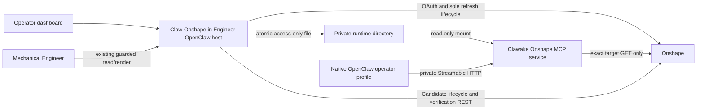

# Self-hosted Onshape MCP architecture — 2026-10-12

ADR-018 amends hosted-auth assumptions without erasing ADR-006/016/017. The local
MCP uses upstream f78ddc48a445765f32fcf052d9d8e6d709497d56 with one isolated patch.
Initial deployment is read-only. CAD mutation remains blocked by the missing
supported native plugin-owned invocation contract.

Process topology: a rootless Quadlet/systemd unit runs a separate non-root MCP
container. It has a read-only root filesystem, /tmp tmpfs, no published ports,
no Podman socket, no agent workspace, no unrelated secrets, and only two mounts:
private access-token directory (read-only), and non-secret configuration (read-only).
Its dedicated bridge network permits provider HTTPS egress. Only Engineer is
attached as a client; Lead remains on its existing A2A network. Engineer's plugin
host mounts the token directory read/write; agent filesystem/tool grants are not
extended. Native production registry points to http://clawonshape-mcp:8080/mcp
and stays disabled. An operator-only native profile can enable discovery without
exposing raw tools to production Engineer sessions. No custom proxy is present.

Clawake's generic v2 services remain model-only. The focused `clawake onshape-mcp`
command reuses existing ArtifactChange/apply_artifacts and SystemdService for
plan/apply/status/restart. It requires a digest-pinned image, validates private
mount ownership/permissions without reading token contents, renders network and
container Quadlets, applies atomic artifacts, reloads systemd and restarts. Team
`onshape_mcp: true` reconciles a disabled native local registry entry. Adoption is
restricted to an explicitly disabled known hosted connector; unrelated unmanaged
configuration is refused. Existing bindings, grants, A2A and Discord are retained.

Claw-Onshape's `localMcp` configuration identifies one existing owned connection
and a private runtime directory. Existing consent, refresh and disconnect all use
the same private credential store and lock. Before save/invalidation, the local
handoff is replaced with null. A successful save publishes exactly accessToken,
expiresAt (epoch milliseconds), and scopes. No refresh token, OAuth client secret,
requester identity, credential path or raw native output is returned to agents.
A 15-second plugin lifecycle task maintains the handoff via the existing refresh
owner, serializes synchronization, and revokes on failure or disposal. Existing
expired-provider refresh uncertainty remains a real limit; no independent MCP
refresh can compensate for it.

The patched MCP mode is configured by `[external_token]`, mutually replacing the
runtime's auth path without changing the existing OAuth modes. No OAuth flow,
refresh, retry, token persistence or legacy token watcher runs in this mode. The
file is reread at every API dispatch with a 30-second expiry margin, a bounded
strict schema and opened-inode permission checks. Atomic replacement avoids partial
rotation. Null/missing/malformed/expired files deny calls. HTTP exposes /health
(liveness) and /health/ready (credential readiness). Private network membership
is the local transport boundary; there is no second MCP OAuth issuer.

Tools are upstream tools/list and schemas. External mode invokes only
onshape_api_search, onshape_api_explain, onshape_api_schema, onshape_api_call,
and onshape_auth_status. At the actual request executor every write is rejected,
along with arbitrary headers, request bodies, query strings, other documents,
other mutable workspaces, other elements and unlisted GETs. Bound document metadata,
workspace membership, current microversion, elements and features are allowed;
immutable feature/element reads retain the same document/element binding. This is
read-only containment, not implemented Candidate mutation authorization.

REST retains Candidate preparation, source/revision capture, operator approval,
independent feature/geometry verification and pinned renders. A future guarded
mutation must bind operator approval, requester/session, did, Candidate wid, eid,
feature, permitted operation, expected revision, complete payload digest and a
single durable attempt. It must enforce skew rejection at the provider and fence
UNKNOWN across restart. The service must accept that narrow authorization while
continuing to reject every alternate raw write. The Engineer cannot approve itself.
Native discovery/HTTP compatibility alone does not establish this invocation seam.
