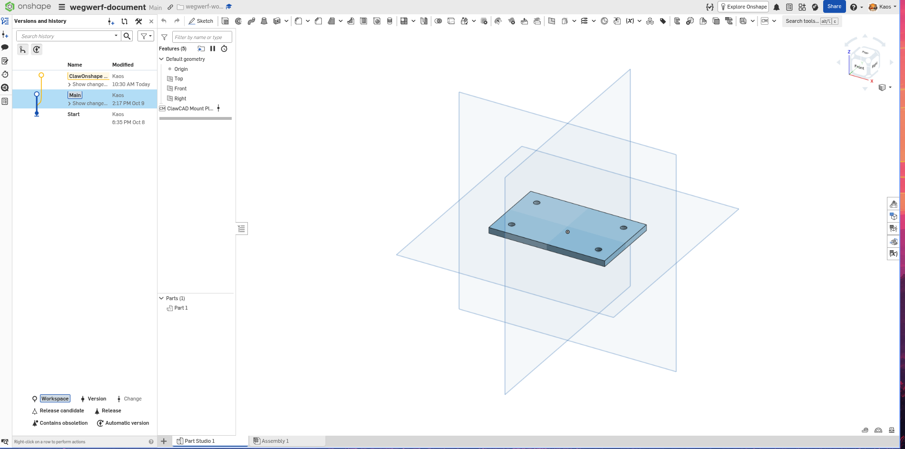
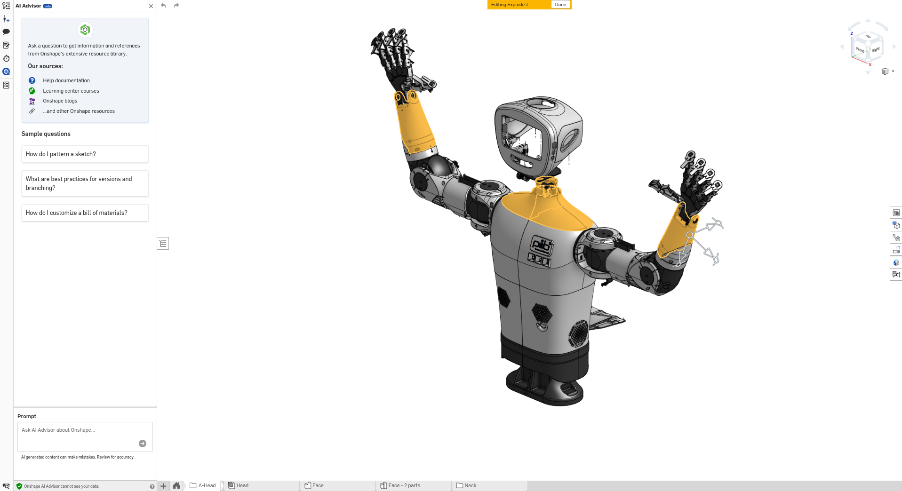

# ClawOnshape product specification

This is the sole normative source of ClawOnshape product requirements.
It consolidates the PO vision/pib journey (2026-10-16) and confirmed goal workflow
(2026-10-21). Intended behavior does not establish deployed availability or authority.
Technical contracts and accepted ADRs govern their own interfaces and boundaries;
dated reports establish only the evidence they actually record.

## Purpose and scope

Help several small teams improve CAD designs and manufacture selected parts
without losing the connection between intent, decisions, revisions and results.
The Robotics Lead is the user contact in the originating channel (initially,
for example, Discord #clawcad). The team must not organize internal delegation.
Saving effort and reducing handoff errors are hypotheses to validate with users.
The plate change and pib selection-to-print journeys below are both required.
Printing is target scope requiring separate acceptance and operational authority;
this specification authorizes no physical start, deployment or permission change.
Additional slicers and printing processes are later scope. General manufacturing,
unattended series production, arbitrary printer support, automatic assembly,
robot control and autonomous physical quality testing are outside this scope.
No automatic merge or promotion to protected Primary is agreed.

## Roles and component ownership

- Humans define requirements, assess usefulness and quality, and approve changes,
  production and physical starts within their separately established authority.
- Robotics Lead clarifies needs, delegates engineering, and returns questions,
  progress, approval needs, results and errors in the correct originating channel.
- Mechanical Engineer inspects CAD, proposes and verifies Candidate changes,
  and owns the technical result including its subordinate print agent's work.
- The print subagent checks STL, prepares the Bambu Studio job, reports limits,
  and starts only a separately approved job on the assigned physical printer.
  This subordination does not mandate a container topology.
- ClawOnshape owns OpenClaw integration, user/task identity, the control plane,
  OAuth and refresh, approval binding, independent verification and delivery.
  onshape-mcp owns generic CAD execution and hard execution admission.
- Clawake owns declarative deployment, reconciliation, pins and service lifecycle.
  Operators provision integrations and permissions outside the runtime agents.

Onshape is the online REST-accessible CAD source. Bambu Studio is the first local preparation application reachable by the Engineer. Both belong in its dashboard.
Architecture chooses their integration; no new service, cost or access route is
implicitly required. Technical limitations must be surfaced before changing scope.

## Communication and dashboard requirements

Each row defines required observable acceptance, including blocked cases.

| ID | Required behavior and acceptance |
| --- | --- |
| K1 | Lead keeps requests, questions, progress, approval needs, results and errors associated with the correct team and originating channel; users need not contact a subagent. |
| K2 | Lead delivers a useful explanation, suitable view and accessible file or authorized link. Internal success without usable user delivery is incomplete. |
| D1 | Engineer dashboard identifies Onshape and Bambu Studio separately and explains their CAD and print-preparation roles. |
| D2 | Each tool shows usability, freshness and next action; missing setup/permission, unreachable, error, unknown and stale states are distinguishable. |
| D3 | Show actual capability availability or blockers for CAD reads, mutation, STL export, slicing and print handoff. Reachability alone grants none of these. |
| D4 | Show authorized team/project, relevant printers and profiles; foreign team data is inaccessible. |
| D5 | Dashboard and channel agree on task, current step, result, outstanding approvals and blockers. Unknown state is never presented as success. |

Use three main views: Workspace for context/connections, CAD for goals and the
associated Candidate, and 3D Print for STL import, profiles, slicing and job preview.
Further supported tools fit the Workspace structure without extra main navigation.
Keep the confirmed dark cockpit hierarchy, large CAD view and restrained panels;
see the [visual assignment](docs/product/dashboard-workflow-2026-10-21/README.md#visuelle-referenzen).
Names load independently of renders. Refresh, errors, target switches and late
responses must not mix old names, images or revisions into the current context.
Loading or selecting a view never starts a mutation. Show real Onshape branch
relationships and revision links; do not invent ancestry or CAD observations.

## Select an Onshape work context

Task: COC-CONTEXT-SELECTION-20261021. This required journey extends the product
specification; it does not claim an implemented selector or expand authority.
Supporting [mockups and assignment](docs/product/onshape-selection-2026-10-21/README.md)
illustrate the confirmed direction with sample data. The criteria below are normative.

From the existing Workspace work-context card, and the same entry in CAD, choose
Document → authorized Onshape Workspace → exactly one existing Part. Search is
available at each step; Parts are grouped by Part Studio. A Part Studio is a
container, never an individual Part. Names, document/workspace/Part Studio
provenance, secondary short identifiers and a matching preview distinguish
same-name and left/right Parts without requiring ID entry. A single authorized
document is preselected. Workspace roles (protected Primary, goal-owned Candidate,
unknown) require evidence; visibility does not make a Candidate reusable.
Assemblies, occurrences and unsupported elements/configurations are explained
rather than represented as editable Parts.

Choices remain provisional until explicit “Auswahl übernehmen” succeeds.
Changing document clears workspace and Part; changing workspace clears Part.
Incomplete, loading, invalid or unverified choices cannot be adopted. Cancel,
Escape and closing discard the draft without changing the confirmed selection.
At adoption the server rechecks trusted subject/task assignment, provider read
access, document/workspace/Part Studio/Part membership, configuration, observed
revision and outstanding work. Stale selection revisions or changed observations
require refresh/review rather than silently adopting different data. Failed
adoption preserves the previous confirmed reference; if that reference itself
lost access or validity, mark it unusable and suppress unauthorized cached data.

After successful adoption the dialog MUST close. The existing work-context card
MUST return to a compact presentation: Part name, document, Onshape Workspace,
Part Studio, observed revision/freshness, Onshape link and “Auswahl ändern”.
No permanently large preview, expanded lists or open selection fields remain.
Workspace and CAD show the same confirmed selection. Reopening restores that
selection for revalidation. “Weiter zu CAD” only navigates; it starts no CAD work.

Persist confirmed selection for the same authorized task across refresh/reopen;
keep drafts local. It must not switch another task, team, requester or channel,
rewrite global bindings or retarget a shared MCP executor. Derive scope from
trusted identity, not browser-supplied ownership. Missing or ambiguous task
association blocks adoption. Concurrent stale adoption fails rather than silently
overwriting another confirmation. Exact session association, authorized adopter
and sharing/retention policy require review before implementation.

Store a revision-qualified Part reference with document, workspace, Part Studio,
observed microversion and explicit supported configuration. A raw partId is not
a permanent identity; names are labels. Revalidate before later use and across
revision/Candidate transitions. Missing, split, merged or ambiguous identity
blocks use until clarified; never substitute by name. Selection does not freeze
a mutable workspace. Old element-only data remains inspection context, not a
confirmed single-Part selection; do not migrate it by guessing the first Part.

Any nonterminal goal, outstanding confirmation/approval or unresolved legacy,
Candidate-preparation or mutation attempt blocks adopting a different context.
STOP, expiry or a blocked goal alone does not clear this interlock: reconcile
uncertain outcomes and explicitly close the old goal where supported. Unknown
work status fails closed. Adoption and goal confirmation must be serialized.
Existing goal scope, Candidate ownership, approvals, images and evidence retain
their original identities; none transfers to a new selection. Retain historical
evidence under its old goal, without presenting it as current selection evidence.

Selecting a Part expresses intent, not feature-level geometric containment.
Before separate goal confirmation, disclose affected and preserved Parts and
verification limits; a feature may affect other Parts in the Part Studio.
Unresolved wider effects block confirmation until clarified within authorized
scope. The current new-goal policy still creates one Candidate from confirmed
Primary. A selected non-Primary workspace cannot silently become a new source,
reuse another goal's Candidate or fall back to Primary while displaying another
selection. Unsupported source/handoff stays visibly blocked pending a contract
and, if necessary, human source-policy decision.

All search, metadata and preview responses are bounded and filtered against the
existing assignment before returning names, counts or data. OAuth visibility
alone is insufficient. Cache/request identity includes authorization scope,
connection, selection revision, complete target, Part, configuration and observed
microversion. Parent switches invalidate descendants; late responses are ignored.
Revocation/reconnect, binding or revision changes invalidate readiness and related
cached projections/confirmation drafts. A preview must match the concrete Part
and observed stand; otherwise show “Vorschau nicht verfügbar” and an authorized
Onshape link. A whole-Part-Studio render must not masquerade as a selected-Part
preview. Failures offer an explicit retry without reusing stale geometry.

| ID | Required observable acceptance |
| --- | --- |
| S1 | Select document, workspace and exactly one actual Part without entering IDs; distinguish multiple Parts within one Part Studio. |
| S2 | Same-name and left/right examples remain distinguishable by provenance and revision-matched preview; unavailable preview is explicit. |
| S3 | Cancel preserves context; successful adoption closes the dialog, synchronizes Workspace/CAD and restores the compact card without large preview or open selection fields. “Auswahl ändern” reopens the previous selection. |
| S4 | Parent changes, rapid selection, late replies, stale revisions and load failures never mix names, IDs, configurations, revisions or images. |
| S5 | Server rejects foreign/unassigned contexts and missing read authority; OAuth visibility or selection grants no additional rights or apparent success. |
| S6 | Active/nonterminal goals and unresolved work prevent adoption of another context; old approvals, Candidate ownership, images and evidence never migrate. STOP alone is insufficient. |
| S7 | Search, preview, adoption and navigation cause no CAD mutation, Candidate creation or approval call. Protected Primary stays protected. |
| S8 | Empty lists, no search matches, expired connection, access loss and disappeared Part each explain a useful next step (retry, change search, reconnect, review assignment or reselect). |
| S9 | Keyboard, visible focus, text selection status, Escape/cancel/return focus work without color alone. Verify 1440×900, 1366×768 and 390×844; narrow layout stacks the steps and keeps summary/adoption accessible. |

This increment excludes global Onshape search, new OAuth rights or team/channel
bindings, multiple selection, assembly occurrence resolution, version browsing,
branch creation, automatic goal stop/migration, merge, export, print and runtime
or deployment actions. The wider required pib journey remains in scope.
Implementation acceptance requires contract/identity/isolation/race evidence and
browser evidence before/during/after adoption for S1–S9. Real provider/user
acceptance is separate; mockups and fixtures do not establish live availability.

## Required capabilities

| ID | Required behavior and acceptance |
| --- | --- |
| F1 | Bind teams, projects and authority explicitly. Teams can use only their assigned models, artifacts, approvals and printers; authorized approvers are known. |
| F2 | Inspect the concrete model, explain observed properties and limits with an appropriate view, and let users confirm the exact assembly part, side, revision and quantity. |
| F3 | Deliver an independently checked Candidate with understandable before/after evidence and preservation checks; protected source/Primary remains unchanged. |
| F4 | Obtain production approval for a fixed checked CAD revision and selected parts/quantity; a change approval is insufficient. |
| F5 | Reproducibly export STL from that approved revision and selection; retain source, units, export parameters and file identity. Deliver the accessible STL and matching view with checked dimensions. |
| F6 | Hand the correct STL, team, requirements and approval context to the Engineer's print subagent; record acceptance or a reasoned rejection. |
| F7 | Check STL usability and prepare in Bambu Studio; expose physical printer, profiles, orientation, supports, quantity, preview, time/material estimates and open issues for the supported scope. |
| F8 | Start only the checked, separately start-approved job on its assigned printer. Approval binds file, printer, material, quantity and relevant settings. |
| F9 | Report confirmed start, progress, known completion/errors and next action through Engineer and Lead. Reconcile uncertain starts before considering another start; no automatic duplicate. |

## Bounded goal workflow

Before confirmation show goal, measurable success conditions, preservation
conditions, team, document, element, source revision, Candidate plan, permitted
features/operations, attempt budget and lifetime. An authorized human confirms
this bounded goal once. The Engineer may then make the necessary permitted
changes in the same Candidate without a new user release for every payload.

Create one Candidate from the confirmed Primary revision when activating the
goal; reuse it for subsequent iterations, refresh and resume. A changed scope
requires a new confirmation of a goal revision, not a fresh Candidate per step.
The initial accepted technical scope is updates to listed existing features;
new-feature operations need a later contract extension, not inferred permission.
Defaults are 10 dispatches and two hours, capped at 25 dispatches and eight hours,
as decided in the [goal ADR](docs/ADR.md#adr-2026-10-21-goal-scoped-mutation-authorization).

Show aggregate progress, remaining bounds, blockage, stop/expiry, reconciliation
and evidence-backed completion; keep detailed history accessible secondarily.
Iterate until conditions are verified or a budget, time, authority or other
blocker stops work. Do not manufacture goal authorization by auto-approving or
batching legacy payload approvals. Reject foreign teams, Primary writes,
out-of-scope operations and absent/revoked authority at execution admission.

STOP prevents subsequent dispatches; an in-flight attempt is recorded and
reconciled. Executed changes are not automatically rolled back. Resume after
STOP or expiry needs new human confirmation and retains the goal's Candidate.
Resolve uncertain outcomes before further writes; never blindly retry them.
Goal/scope changes need confirmation; routine permitted steps need no user query.
Independent verification checks goals and preservation at the resulting revision.
Tool success or individual receipt counts alone cannot complete the goal.
Return result, checks, open limits and revision link through Lead to the origin.

The accepted interim confirmation is the dashboard's explicit "Verify Candidate"
act under operator authority, with code checking identity, displayed scope,
nonce and expiry. A later credential verifier replaces that adapter. This does
not settle future multi-team approver identity or production/start approval UX.
Existing guarded Operator actions remain accessible and collapsed during the
transition until the goal path is live-accepted. No automatic confirmation on load.

## Plate change journey

Human-supplied reference, not proof of a completed change. Example: "Prepare a
variant with 5 mm mounting holes; preserve positions and outside dimensions."
The 5 mm is illustrative; actual dimensions and editable features come from CAD,
never from measuring the screenshot. Visible history alone proves no mutation.

1. Lead identifies the plate and revision, explains current holes with evidence
   and a view, and resolves ambiguous intent.
2. Engineer proposes target dimensions and explicit preservation conditions.
   Human confirms the bounded change goal and Candidate scope.
3. Engineer changes only the Candidate, checks the requested holes and preserved
   positions/outside dimensions, and confirms Primary preservation. Parameter
   checks and images alone are not proof of complete geometric correctness.
4. Lead delivers before/after views, observed values/units, revision links and
   remaining verification limits. Human can accept, request another iteration,
   or separately approve production. Printing is unnecessary for this acceptance.

## pib selection-to-print journey

Human-supplied reference with unproven capture date/revision. Highlights do not
select a production part or approve a change. The visible Onshape AI Advisor is
not the agreed ClawOnshape user interface. Example: one pib forearm cover.

1. Lead records team/channel, intended use, quantity and requirements. Show the
   assembly context and verify the exact part, side and revision with the team.
2. If a change is needed, complete the plate-style Candidate journey first.
   This manufacturing journey must also work for an unchanged existing part.
3. Obtain independent production approval for the fixed CAD stand, part and
   quantity. Later CAD changes must not silently alter this approved export.
4. Export matching STL with provenance, units, dimensions, parameters and file
   identity; provide it to the user and obtain the print subagent's handoff response.
5. In Bambu Studio choose printer model, nozzle, material and process profiles;
   distinguish slicing profile from the exact physical printer. Import and check
   scale, build volume, orientation, supports and quantity, then slice.
6. Present accessible preview, settings, estimates and risks. Wrong profile,
   incompatible build volume, unusable STL or slicing failure blocks preparation
   with a clear next step. If Bambu is unavailable, retain the approved STL status.
7. Obtain separate human start approval for this exact prepared job. Start once,
   report confirmed job identity/progress/completion or errors in the origin,
   and reconcile uncertain start outcomes before any further dispatch.
8. Human inspects and uses the part on pib, records quality against agreed
   criteria and decides on further work. Printer completion alone proves no
   physical quality or mechanical suitability.

## Independent approvals and open decisions

Change/goal confirmation, production approval and physical-start approval are
three independent decisions. Production approval permits named-revision export
and preparation; it does not promote Primary. Status displays or channel messages
do not create authority. Missing approval or a wrong revision blocks handoff.

The following PO decisions remain open:

- Pilot teams, part class, printer models and materials for first acceptance.
- Who may approve each stage per team, and where authenticated production/start
  approval happens. Interim dashboard operator authority does not decide this.
- Required production-order fields (including use, material and quantity) and
  the on-site checks that establish physical printer readiness.
- Proposed reapproval rules: geometry/part-selection changes require renewed
  production approval; printer/material/settings changes require renewed start
  approval. These proposals still require human confirmation. Job changes and
  duplicate delivery must never silently produce a different or extra print.

## Product acceptance and evidence

Accept a concrete plate task through source, proposal, goal confirmation,
Candidate and verified before/after/preservation result. Accept a concrete pib
task through confirmed selection, production approval, revision-bound STL,
preparation, separate start approval, confirmed job and human quality/usefulness
assessment. Partial milestones do not establish complete journey acceptance.
For each step retain task identity, success criteria, revision/artifact/approval
links, dated evidence, open/in-progress/blocked/accepted state and next action;
include the human trial result and iteration decision without mandating storage.

Demonstrate isolation with at least two teams and deliberate wrong assignments
of projects, files, approvals and printers. Demonstrate invalid files, missing
integration/approval, revision drift, stop/expiry and uncertain/duplicate starts.
Validate a pilot STL's dimensions and slicing in the agreed Bambu Studio version.
Check real UI at 1440×900 and a narrow laptop width against the four references,
including keyboard access, focus and status discernible without color alone.
Live CAD/channel/print checks require their own human operational authorization.
Assess whether users save effort and understand approvals; simplify before wider
rollout if overhead or unclear handoffs outweigh the benefit.

[Feature trace](docs/product/feature-trace.md) and
[mutation evidence](docs/evidence/2026-10-16-mutation-path-acceptance.md) are dated
observations, not current availability guarantees. Further acceptance is needed
for full goals, multi-team operation and the complete printing journey; neither
code nor reports substitute for those demonstrations. Active role instructions
remain operational limits until separately authorized migration.

Technical references: [CAD execution contract](docs/interface/onshape-mcp.md),
[goal contract](docs/interface/goal-workflow.md), [ADRs](docs/ADR.md) and
[operating guide](docs/engineering-cockpit.md). Schemas stay there.
